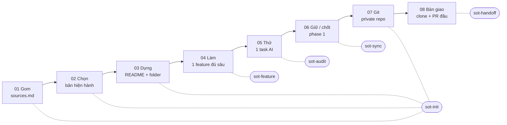

# SoT builder

Bộ skill cho Claude Code giúp designer **dựng và giữ SoT (Source of Truth, nguồn sự thật) cho dự án design**: một thư mục có chỉ mục, nơi người mới và AI cùng tìm được câu trả lời hiện hành, căn cứ của nó và những điều còn chưa chốt.

Bộ skill đi theo quy trình 8 bước trong talk *"SoT cho design bằng AI"*. Mỗi skill gói một việc lặp lại để AI làm nhanh hơn. Quyền quyết định vẫn ở designer và người chốt sản phẩm.

> **Bắt đầu nhỏ, giữ nguồn rõ.** Một tính năng có nguồn và câu hỏi mở tốt hơn một kho file mà không ai biết tin bản nào.

## Đọc theo thứ tự

1. **[Cài đặt](docs/1-cai-dat.md)**: cài công cụ, đăng nhập GitHub, kết nối Figma, cài skill. Làm một lần mỗi máy.
2. **[Quy trình dựng SoT cho dự án mới](docs/2-quy-trinh-du-an-moi.md)**: dùng skill nào, theo thứ tự nào, với câu lệnh mẫu.
3. **[Cách dùng từng skill](docs/3-cach-dung-tung-skill.md)**: khi nào dùng, gọi thế nào, đầu vào, đầu ra.

## 10 skill trong bộ

| Skill | Làm gì | Bước trong quy trình |
|---|---|---|
| **sot-init** | Dựng SoT cho dự án: phỏng vấn, gom nguồn vào `sources.md`, tạo khung README / CLAUDE.md / decisions, Git + private repo | 01 Gom · 02 Chọn · 03 Dựng · 07 Git |
| **sot-feature** | Làm trọn một tính năng: brief/AC, quyết định, câu hỏi mở, danh sách màn nối frame ↔ AC, flowchart, copy, handoff dev | 04 Làm |
| **sot-audit** | Kiểm tra SoT: chấm 6 điều kiện Definition of Done, tìm link chết và mâu thuẫn, chạy thử một task AI | 05 Thử · trước 08 |
| **sot-sync** | Sau mỗi quyết định: tìm mọi file bị ảnh hưởng, lập checklist, sửa đồng loạt, commit | 06 Giữ / chốt (hằng ngày) |
| **sot-handoff** | Bàn giao SoT cho designer khác, hoặc nhận bàn giao: clone, đọc lối vào, PR đầu tiên | 08 Bàn giao |
| spec-review | Review doc PM, chốt doc và design trong khoảng 2 vòng | Hỗ trợ 02, 04 |
| design-system-build | Audit Figma, dựng tài liệu design system (có chế độ tối thiểu cho phase 1) | Hỗ trợ 03 |
| figma-design-rename | Đặt lại tên page / section / frame / layer trong Figma theo quy chuẩn | Hỗ trợ 01, 04 |
| flowchart | Vẽ flowchart luồng tính năng (Mermaid + HTML) | Hỗ trợ 04 |
| document-fullstack-v2 | Viết AC dạng Gherkin, dò edge case | Hỗ trợ 04 |

5 skill in đậm là phần mới của bộ. 5 skill còn lại là skill có sẵn, đã được làm sạch và chỉnh lại để chạy được trong SoT.

## Quy trình 8 bước với skill tương ứng



## Cài nhanh (đã có Git, GitHub CLI, Python)

```bash
gh repo clone ducndiKame/SoT-builder
cd SoT-builder
python3 install.py        # Windows: py install.py
```

Sau đó mở một phiên Claude Code mới và gõ `/` để thấy các skill. Chưa có công cụ nào thì làm theo [Cài đặt](docs/1-cai-dat.md).

## Cập nhật

```bash
cd SoT-builder
git pull
python3 install.py        # chỉ cập nhật skill nào có thay đổi; bản cũ được sao lưu
```

## Góp ý và sửa skill

- Sửa trong thư mục `skills/<tên>/` của repo này, không sửa bản đã cài trong `~/.claude/skills/`. Lần cài sau, bản đã cài sẽ bị ghi đè.
- Tạo branch, sửa, mở pull request, ghi rõ tình huống thật khiến bạn muốn sửa. Skill tốt lên nhờ bài học từ dự án thật.
- Mọi skill dùng thư viện chuẩn của Python 3, chạy được trên cả macOS và Windows. Đừng thêm script chỉ chạy được trên một hệ điều hành.

## Cấu trúc repo

```
SoT-builder/
├── README.md                ← file này
├── install.py               ← cài skill vào ~/.claude/skills
├── docs/                    ← cài đặt, quy trình, cách dùng từng skill (.md + .html)
├── skills/<tên-skill>/      ← mỗi skill: SKILL.md + scripts/ assets/ references/
└── .claude-plugin/          ← để cài theo dạng plugin của Claude Code (tuỳ chọn)
```
