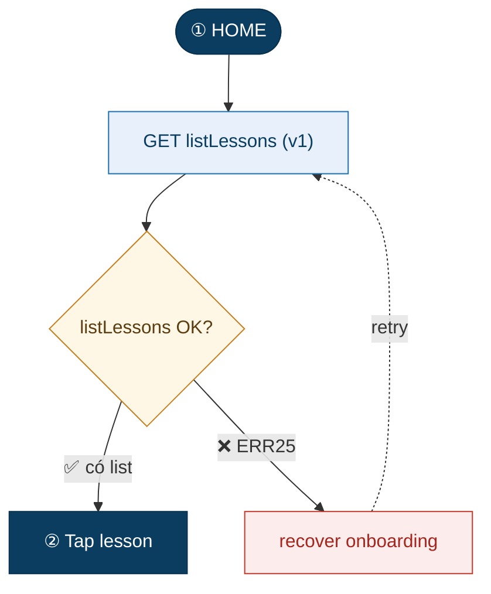

# Mermaid conventions — flowchart luồng app

Viết `flowchart TD` (top-down). **Luôn bọc nhãn trong dấu ngoặc kép** để an toàn ký tự đặc biệt (`/ ( ) · : ?`). Gán class bằng `:::class` ở lần định nghĩa node đầu tiên; lần sau chỉ dùng id.

## Node types (visual grammar)

| Dùng cho | Cú pháp | Class |
|---|---|---|
| Màn hình / Terminator (start·end) | `ID(["① HOME"])` | `:::screen` |
| API call | `ID["POST scoreLesson (v2)"]` | `:::api` |
| Quyết định (API OK? / rẽ dữ liệu) | `ID{"scoreLesson OK?"}` | `:::dec` |
| Node lỗi có retry | `ID["retry 3x → toast"]` | `:::fail` |
| Node lỗi → thoát/kết thúc | `ID[".scoringAborted → Home"]` | `:::stop` |
| Rẽ nhánh khác (không phải lỗi) | `ID["→ Summary (resume)"]` | `:::alt` |

## Nhánh (edge labels)

- Thành công: `D1 -->|"✅ có list"| NEXT`
- Thất bại + **mã lỗi**: `D1 -->|"❌ ERR107·403 LOCKED"| E1`
- Retry loop (nét đứt): `E1 -.->|retry| A1`
- Rẽ theo dữ liệu: `D3 -->|"TRUE (+convId)"| RS` · `D3 -->|"FALSE"| SD`

Mỗi hình thoi API nên có **≥1 nhánh ✅** (đi tiếp) và **các nhánh ❌** (mỗi loại lỗi 1 nhánh, kèm mã lỗi + hành động thật trong code).

## Endpoint prefix (Apero iOS)

Ghi rõ trong nhãn API: `(v2)` = `sdk.learningV2.*` (mới) · `(v1)` = `sdk.learning.*` (cũ) · `S3` = upload · `cfg` = client/remote-config. Kèm `file:line` khi có (vd `NewQuizSessionViewModel:314`).

## Bảng màu classDef (dán cuối file .mmd)

```
classDef screen fill:#0b3d61,color:#ffffff,stroke:#08324f,stroke-width:1px;
classDef api    fill:#e8f1fb,color:#0b3d61,stroke:#1a6fb0,stroke-width:1px;
classDef dec    fill:#fff7e6,color:#5b3d10,stroke:#c67f1e,stroke-width:1px;
classDef fail   fill:#fcecec,color:#a5261e,stroke:#c0392b,stroke-width:1px;
classDef alt    fill:#eef0f2,color:#41505f,stroke:#8a94a0,stroke-width:1px;
classDef stop   fill:#f6d7d4,color:#7a1a12,stroke:#b3261e,stroke-width:1.5px;
```

## Mã lỗi thường gặp (Apero learning flow)

| Code | HTTP | Nghĩa | Xử lý app |
|---|---|---|---|
| ERR25 | — | chưa xong onboarding | recover + retry |
| ERR107 | 403 | lesson LOCKED/UPCOMING | error sheet |
| ERR24 | 404 | conversation/lesson not found | lỗi generic |
| ERR100 | 400 | scoreLesson khi chưa preliminary | gọi /preliminary rồi chấm lại 1× |
| ERR105 | 408 | quiz timer server hết hạn | chặn bằng drillDetail trước quizEval |
| ERR111 | 409 | trả lời trùng | alreadyAnswered → bỏ qua |
| ERR108 | 401 | token hết hạn | SDK tự refresh |
| ERR17 | 504 | upstream/AI Core timeout | log + retry theo layer |
| network/SSE/S3 | — | mất mạng/SSE đứt/upload fail | retry/backoff hoặc text-only |

## Khung mẫu tối thiểu



Xem `examples/iip506-app-flow.mmd` cho bản đầy đủ.
